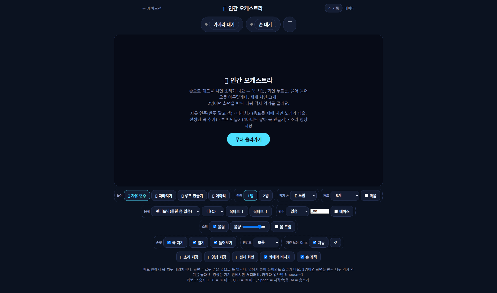
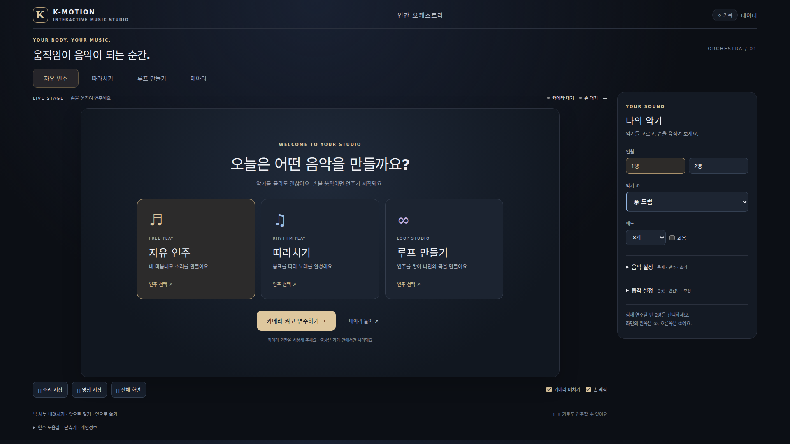
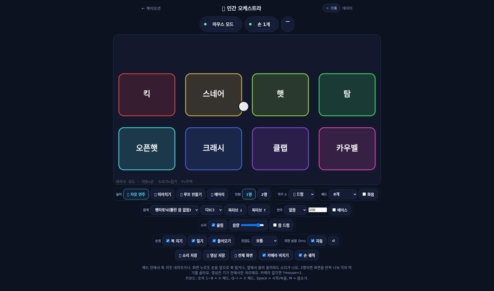
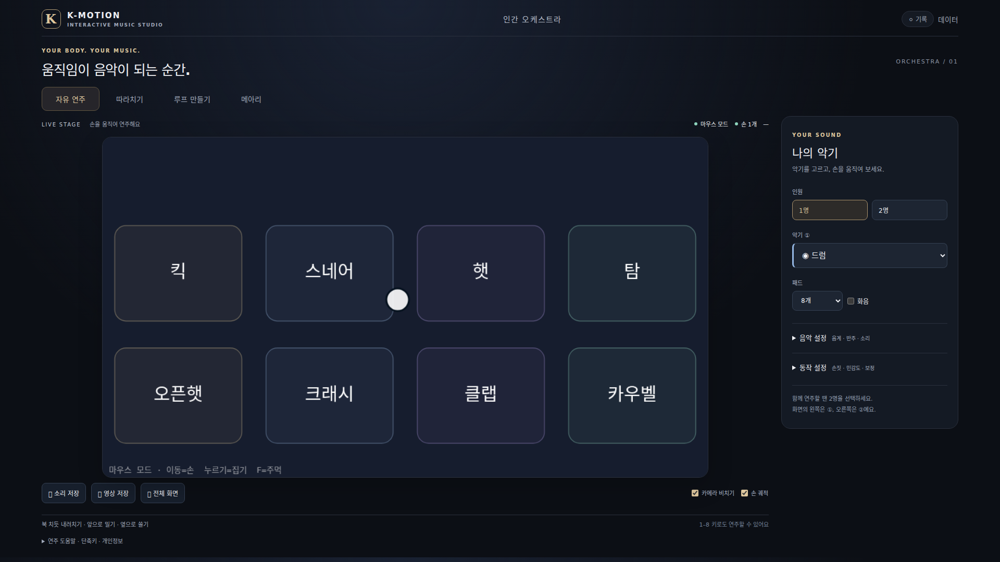
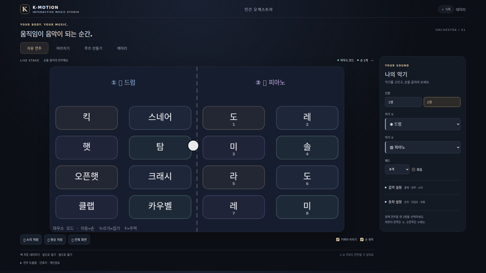
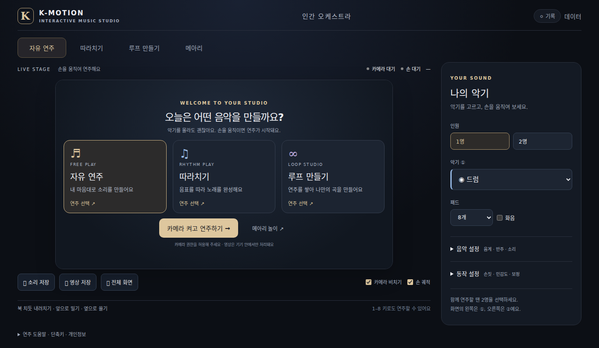
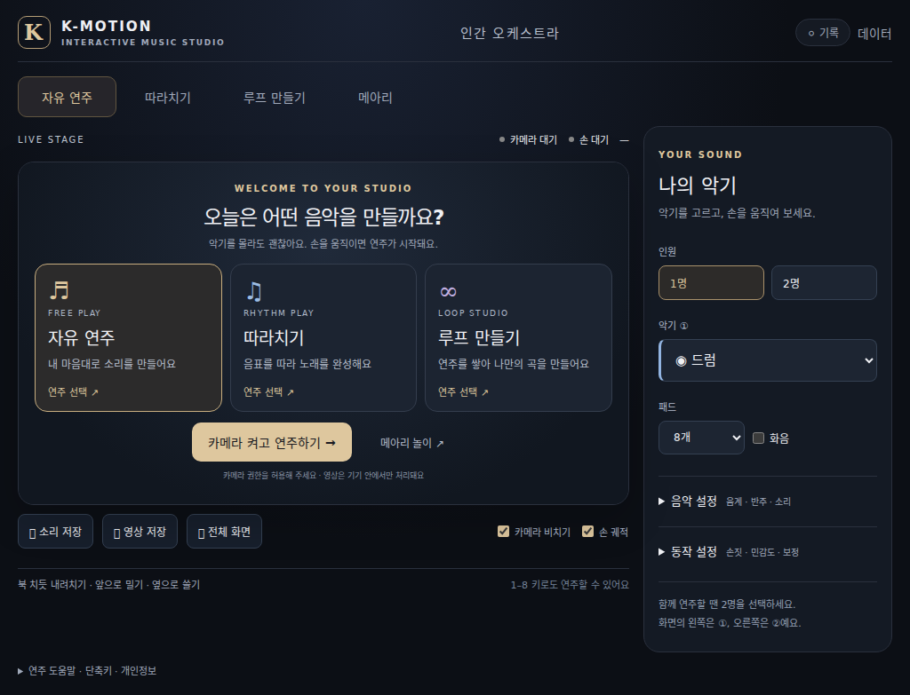
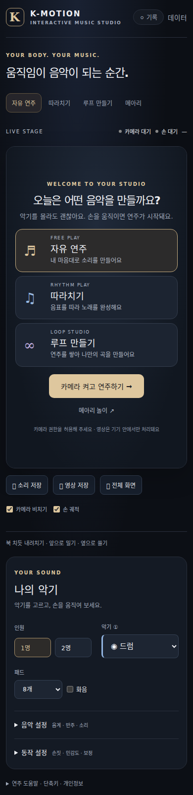

# K-MOTION Orchestra · Premium UI review

운영 배포 없이 `design/orchestra-premium-ui`에서 작업했습니다.
기준 커밋: `28d2f6069a92ff0b2bfa730b75a595e1b2d7e153`.

## 변경 범위

| 파일 | 변경 내용 |
| --- | --- |
| `kmotion/orchestra.html` | 기존 컨트롤 재배치, 시작 화면 카드, 캔버스 색상·선 두께·카메라 오버레이 명도 |
| `kmotion/orchestra-premium.css` | 이 페이지 전용 네이비·샴페인 테마, 반응형 레이아웃, 설정 접기, 포커스 표시 |
| `kmotion/orchestra-premium.js` | 시작 카드 → 기존 모드 버튼 연결, 선택 상태 접근성, 컨트롤 레이블, 악기 아이콘 통일 |
| `review/orchestra-premium/*` | 전후 캡처, 검증 코드와 결과 |

공용 `kmotion.js`, `kmotion-data.js`, 공용 CSS는 변경하지 않았습니다. 모든 기존 ID와 모드, 옵션을 유지했습니다. 동작 감지·타격 판정, 소리 합성, 반주, 따라치기, 메아리, 루프, 저장 코드는 원본과 동일합니다. 파티클 수나 새 렌더링 루프, 라이브러리를 추가하지 않았습니다. 악기 패드는 기존 좌표·크기를 유지합니다.

## 화면 비교

| 영역 | 이전 | 이후 |
| --- | --- | --- |
| 시작 | 긴 설명과 시작 버튼 | 3개 모드 카드 + 메아리, 선택 후 카메라 시작 |
| 설정 | 무대 아래 여러 줄에 모두 노출 | 오른쪽 악기·인원 패널, 음악/동작 설정 접기 |
| 무대 | 최대 1040px | 화면 크기에 맞춘 16:9 무대, 1080p 기본 화면에 주요 버튼 표시 |
| 연주 효과 | 진한 무지개 테두리 | 골드·블루·바이올렛·민트의 절제된 파동/테두리 |
| 2인 | 공통 색상 표시 | 플레이어 1 블루, 플레이어 2 바이올렛 표시 |

### 시작 전후

### 연주 전후

### 작은 화면

## 검증

Chromium에서 원본/수정본에 동일한 마우스 시연 및 키보드 테스트를 실행했습니다. 원본 18개 검사와 수정본의 같은 18개 검사 모두 통과했고, 추가 시작 카드 4개 연결도 통과했습니다. 브라우저 런타임 오류 0개. 결과: [functional-results.json](functional-results.json).

- 1인 시작, 2인 전환과 두 플레이어 키보드 타격
- 악기 변경, 5패드, 음계·기준음·옥타브
- 반주 선택, 카메라 비치기·손 궤적 체크박스
- 따라치기 시작·음표 생성, 미리 듣기 버튼 실행, 선생님 곡 저장/삭제
- 메아리 시작, 루프 실제 시간 경과 녹음·트랙 생성·저장·불러오기·뮤트·마지막 삭제
- 소리 및 영상 녹화 종료 후 크기가 0보다 큰 WebM Blob 2개 생성
- 전체 화면 진입 및 종료
- 1920×1080, 1366×768, 1024×768, 390×844 화면 캡처. 작은 화면의 가로 넘침과 시작 버튼이 오버레이 밖으로 잘리는 현상 없음
- 기존 DOM ID 누락 없음. 감지·타격 및 오디오/곡/루프/저장 구간 원문 비교 일치

**미검증:** 실제 웹캠 권한·연결, 실제 1인/2인 손·몸 인식, 교실 전자칠판 실기 성능과 지연, 녹화 파일의 사람이 듣고 보는 품질. 카메라 대신 기존 `?mouse=1`을 사용했습니다. 캡처 속 빈 무대는 이 시연 모드의 실제 화면이며 실제 카메라 영상처럼 합성하지 않았습니다. 성능 향상을 수치로 주장하지 않습니다.

## 로컬 검토

저장소 루트에서 `python -m http.server 8000` 실행 후 `http://localhost:8000/kmotion/orchestra.html?mouse=1`을 엽니다. 카메라 검토 시 `?mouse=1`을 제거합니다. 서버 중지는 Ctrl+C.

회귀 검증: 설치된 Chromium 경로를 `CHROMIUM_PATH`로 지정하고 `node review/orchestra-premium/verify.cjs` 실행. `playwright-core`와 기준 커밋의 Git 객체가 필요합니다. 화면 캡처는 `screenshots.cjs`를 같은 방식으로 실행합니다. 테스트는 임시 브라우저 컨텍스트만 사용하며 운영 데이터에 접근하지 않습니다.

배포 전 실제 카메라로 1인/2인 및 오디오 출력을 확인하세요. 병합 및 운영 배포는 수행하지 않았습니다.
